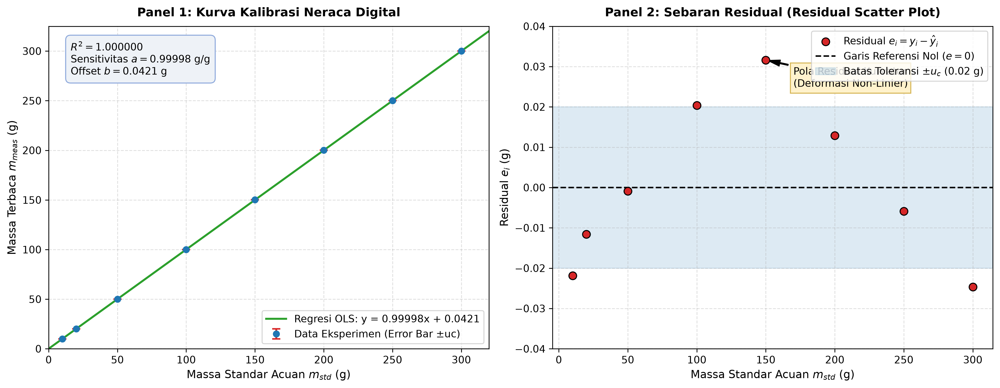

# Metrology & Instrumentation Audit: Uncertainty Propagation, OLS Calibration, and Dynamic Sensor Error Analysis

> **Project-Based Physics Instrumentation & Metrology Engineering Case Study**  
> End-to-end metrological evaluation combining **ISO-GUM uncertainty propagation** (symbolic differentiation via `SymPy`), **OLS calibration & residual diagnostics**, and **optoelectronic response-delay root-cause analysis** across static (*Brass Cylinder Density*) and dynamic (*Air-Track Mechanical Energy*) experimental systems.

[](Laporan_Audit_Instrumentasi_Group_I.pdf)
[](Audit_Metrologi_Group_I.ipynb)
[](Audit_Instrumentasi_Group_I.xlsx)
[-blue?logo=latex)](Laporan_Audit_Instrumentasi_Group_I.tex)

---

## Project Overview

In precision experimental physics and sensor engineering, high precision ($R^2 \approx 1$ or low random scatter) often masks **systematic instrumental flaws**—such as load-cell non-linearity, zero-point drift, or dynamic sensor latency.

This project implements a full **Metrological Instrumentation Audit** pipeline across two paired benchmark systems ($n = 8$ repeated trials per measurand):
1. **Static System Audit (Density Metrology — Experiment P1):** Evaluates mass, diameter, and height measurements of a brass cylinder using a digital analytical balance and vernier caliper, quantifying Type A/B uncertainties and variance budgets via ISO-GUM.
2. **Dynamic System Audit (Mechanical Energy & Photogate Latency — Experiment M3):** Audits mechanical energy conservation on an inclined air track with dual photogates, diagnosing an apparent non-physical energy gain ($\Delta E < 0$) as a systematic optoelectronic comparator delay ($\tau \approx 0.8\text{ ms}$) rather than a physical violation.
3. **Structured Balance Calibration & Validation:** Performs 8-point Ordinary Least Squares (OLS) calibration ($10\text{--}300\text{ g}$, Class F2 reference masses) and proves via residual analysis why $R^2$ alone cannot validate linearity.

---

## Key Technical Highlights & Findings

| Domain | Method / Diagnostic | Quantitative Result | Engineering Insight |
| :--- | :--- | :--- | :--- |
| **Static Metrology (P1)** | ISO-GUM propagation ($k=2$) | $\rho = (8.493 \pm 0.035)\ \text{g/cm}^3$ ($0.41\%$ rel.) | Variance budget shows **$85.4\%$** of uncertainty stems from diameter $d$; upgrading caliper ($0.05\text{ mm}$) to micrometer ($0.01\text{ mm}$) is far more effective than increasing sample size. |
| **Calibration & Linearity** | 8-point OLS + residual curve | $y = 0.999975\,x + 0.0421\ \text{g}$, $R^2 = 0.99999997$ | Despite $R^2 \approx 1$, residuals form a systematic inverted parabolic arc (max $0.032\text{ g}$), indicating subtle load-cell non-linearity. |
| **Instrument Stability** | 30-minute no-load drift test | $+0.03\text{ g}$ zero drift | Equivalent to $3\times$ balance resolution ($0.01\text{ g}$), requiring periodic *tare* reset before measurement runs. |
| **Dynamic Metrology (M3)** | Correlated ISO-GUM propagation | $E_1 = (0.07798 \pm 0.00022)\ \text{J}$<br>$E_2 = (0.08077 \pm 0.00060)\ \text{J}$<br>$\Delta E = (-2.79 \pm 0.61) \times 10^{-3}\ \text{J}$ | $79.6\%$ of $\Delta E$ variance originates from Gate 2 transit time $\Delta t_2$. |
| **Root-Cause Diagnosis** | Photogate delay sensitivity | Sign reversal ($\Delta E = 0$) at $\tau \approx 0.59\text{ ms}$;<br>$\Delta E_{\text{corr}} \approx +0.97 \times 10^{-3}\ \text{J}$ at $\tau = 0.8\text{ ms}$ | Proves apparent energy gain is caused by uncalibrated systematic photogate comparator latency ($\tau / \Delta t_2 > \tau / \Delta t_1$), undetectable by $3\sigma$ outlier filtering. |

### Calibration Curve & Residual Diagnostics



---

## Tech Stack & Pipeline Architecture

- **Computational Analysis ([`Audit_Metrologi_Group_I.ipynb`](Audit_Metrologi_Group_I.ipynb)):**
  - `SymPy`: Symbolic partial derivatives for correlated & uncorrelated ISO-GUM uncertainty propagation.
  - `NumPy` & `SciPy`: $3\sigma$ outlier screening, Type A/B uncertainty evaluation, OLS regression, and parameter error bounds.
  - `Matplotlib`: Dual-panel publication-grade calibration and residual diagnostic plots.
  - `OpenPyXL`: Automated generation of a formatted 3-tab Excel audit workbook ([`Audit_Instrumentasi_Group_I.xlsx`](Audit_Instrumentasi_Group_I.xlsx)) using live Excel formulas without hardcoding.
- **Technical Documentation ([`Laporan_Audit_Instrumentasi_Group_I.tex`](Laporan_Audit_Instrumentasi_Group_I.tex)):**
  - Modular 2-column academic/engineering paper layout (`pdflatex` + `biber` APA citations, vector `TikZ`/`PGFPlots` schematics & charts) compiled to [`Laporan_Audit_Instrumentasi_Group_I.pdf`](Laporan_Audit_Instrumentasi_Group_I.pdf).

---

## Repository Structure

```text
.
├── Laporan_Audit_Instrumentasi_Group_I.pdf   # Compiled 17-page technical audit report
├── Laporan_Audit_Instrumentasi_Group_I.tex   # Main LaTeX report source (2-column layout)
├── Cover.tex                                 # Modular cover page
├── Abstract.tex                              # Modular title, authors, and abstract
├── preamble.tex                              # Typography, siunitx, TikZ/PGFPlots, and BibLaTeX setup
├── tabel_data_mentah.tex                     # Modular raw dataset tables (P1 & M3, n = 8)
├── Pustaka.bib                               # BibTeX reference database (APA style)
├── Audit_Metrologi_Group_I.ipynb             # Full Python analysis & Excel export notebook
├── Audit_Instrumentasi_Group_I.xlsx          # Auto-generated 3-tab Excel metrology workbook
├── Images/
│   ├── Kalibrasi_Residual.png                # Calibration & residual scatter plot
│   └── logo-unair.png                        # Institutional emblem
├── requirements.txt                          # Python package dependencies
├── Makefile                                  # Build automation (`make pdf` / `make clean`)
└── .gitignore                                # Excludes LaTeX aux files & Python caches
```

---

## Quick Start & Reproducibility

### View Deliverables Directly
- **Technical Report:** Open [`Laporan_Audit_Instrumentasi_Group_I.pdf`](Laporan_Audit_Instrumentasi_Group_I.pdf) directly on GitHub.
- **Interactive Analysis:** View [`Audit_Metrologi_Group_I.ipynb`](Audit_Metrologi_Group_I.ipynb) (rendered with outputs and plots).

### Run the Python Analysis Locally
```bash
python3 -m venv .venv
source .venv/bin/activate
pip install -r requirements.txt
jupyter notebook Audit_Metrologi_Group_I.ipynb
```

### Build the LaTeX Report Locally
Requires a TeX distribution with `pdflatex` and `biber` (also compatible with Overleaf using `pdfLaTeX`):
```bash
make pdf
# Clean auxiliary files:
make clean
```

---

## Contributors & Context

Developed at the **Department of Physics, Faculty of Science and Technology, Universitas Airlangga (2026)** as an elaborative instrumentation & metrology engineering project (FIT310 — Group I):
- **Muhammad Abiyu Khansa** (`182241036`)
- **Farras Atha Pandita** (`182241040`)
- **Hendra Maulana** (`182241043`)
- Supervised by **Winarno, S.Si., M.T.** and **Yhosep Gita Yhun Yhuwana, S.Si., M.T.**
